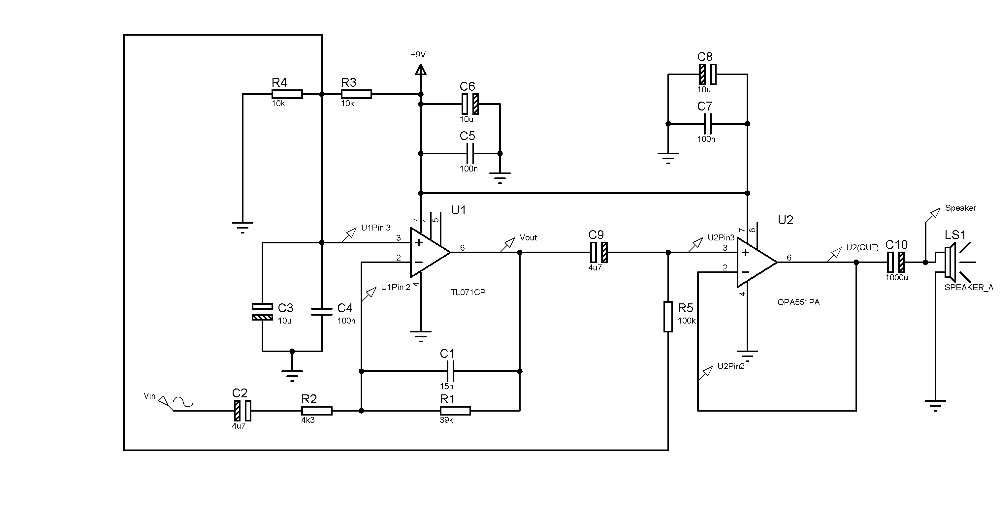
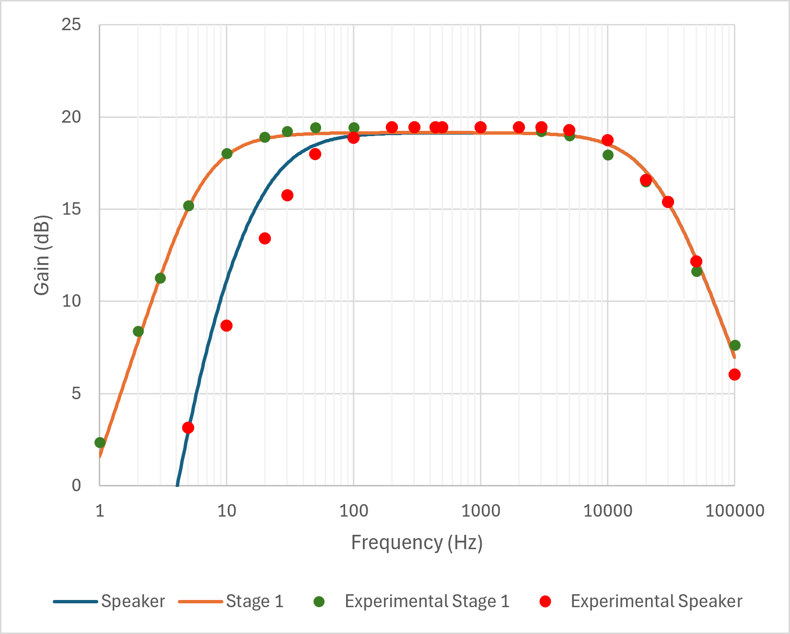
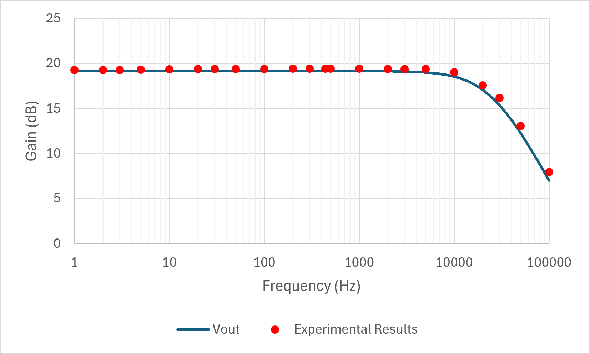

# Two-Stage Audio Amplifier

## Overview

Designed, simulated and constructed a two-stage audio amplifier PCB capable of amplifying audio from a smartphone and driving an 8 Ω speaker.

The project involved analogue circuit design, PCB layout, simulation, physical assembly and experimental testing using Proteus and laboratory equipment.

## Technical Specifications

| Parameter | Value |
|---|---|
| Supply voltage | 12 V DC |
| Audio source | Smartphone |
| First stage | TL071 active band-pass amplifier |
| Second stage | OPA551 output buffer |
| Speaker load | 8 Ω |
| Simulated voltage gain | Approximately 19.4 dB |
| Measured voltage gain | Approximately 19 dB |
| Measured frequency response | Approximately 10 Hz – 25 kHz |
| Design software | Proteus |

## 1. Circuit Design

The amplifier uses two operational amplifier stages.

The first stage uses a TL071 operational amplifier to provide voltage gain and frequency filtering. The second stage uses an OPA551 to buffer the amplified signal and provide sufficient output current to drive an 8 Ω speaker.

The circuit also incorporates signal biasing, power supply decoupling and output protection.

### Complete Circuit Schematic

## 2. PCB Design

Following circuit simulation, the amplifier was transferred into a PCB layout using Proteus.

The PCB design involved component placement, copper track routing and arranging the circuit connections for physical assembly.

### 3D PCB Model

### Top Copper Layer

### Bottom Copper Layer

## 3. PCB Assembly

The PCB was physically assembled and tested using laboratory equipment.

### Assembled PCB - Top View

### Assembled PCB - Bottom View

## 4. Simulation and Experimental Testing

Circuit simulations were carried out in Proteus before the assembled PCB was tested experimentally.

The testing focused on voltage gain and frequency response to evaluate whether the physical circuit performed as expected.

### Amplifier Frequency Response

The amplifier's frequency response was evaluated to assess its gain across different input frequencies.

### Power Supply Frequency Response

The power supply test results are shown below.

### Results and Analysis

The simulated amplifier voltage gain was approximately 19.4 dB, while the measured gain was approximately 19 dB.

The measured frequency response extended from approximately 10 Hz to 25 kHz.

The close agreement between simulated and measured voltage gain demonstrates that the physical circuit performed similarly to the simulation predictions.

Differences between theoretical, simulated and measured results were considered during experimental validation.

## 5. Technical Report

The full engineering report documents the circuit design, component selection, calculations, Proteus simulations, PCB development and experimental testing.

[View Full Audio Amplifier Technical Report](documentation/Audio%20Amplifier%20Report.pdf)

## Tools and Technologies

- Proteus Design Suite
- Analogue circuit design
- Operational amplifiers (TL071 and OPA551)
- PCB design and layout
- PCB assembly
- Circuit simulation
- Oscilloscope and function generator
- Frequency-response measurement
- Experimental testing and validation

## Project Summary

This project provided practical experience in taking an analogue electronic circuit from initial design and simulation through PCB implementation and physical testing.

It strengthened my understanding of operational amplifier circuits, PCB design, frequency response and the relationship between simulated and experimental circuit behaviour.

